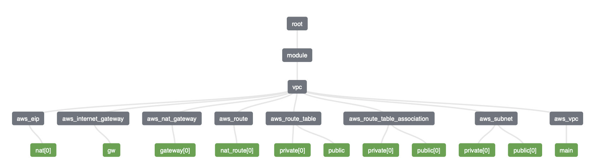
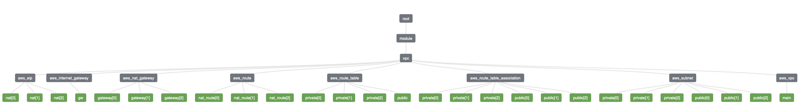

# 🏗️ AWS Infrastructure Deployer

Modular Terraform configuration that provisions AWS infrastructure including a Virtual Private Cloud (VPC) and an Amazon EKS cluster. The VPC module supports single-AZ and multi-AZ topologies, while the EKS module creates a dev/test Kubernetes cluster with Spot instances for cost efficiency.

## ✨ Highlights

- Creates a VPC, public and private subnets, routing, and egress components in one apply.
- Provisions an EKS cluster with managed node groups on Spot instances.
- Switches between single-AZ and multi-AZ deployments with a boolean flag.
- Supports one shared NAT Gateway (cost-optimized) or one per AZ (high availability).
- Includes OIDC provider for IAM Roles for Service Accounts (IRSA).
- Exposes outputs for downstream use (cluster endpoint, CA certificate, subnet IDs, and more).

## 🖼️ Visual Overview

| Single-AZ layout | Multi-AZ layout |
| --- | --- |
|  |  |

- The single-AZ deployment keeps costs low while still providing separate public and private tiers.
- Multi-AZ mode scales the same topology across several AZs for higher availability.

## 🗂️ Repository Layout

- `main.tf` roots the deployment in `eu-central-1` and consumes both modules.
- `modules/awsvpc` contains the reusable VPC module logic and variable definitions.
- `modules/eks` contains the EKS cluster module with IAM roles, security groups, node group, and OIDC provider.
- `TerraformVisual/` holds topology diagrams and Terraform plan outputs for reference.
- `output.tf` surfaces the module outputs from the root configuration.

## 🧰 Prerequisites

- Terraform 1.5.7 or newer (module tested with Terraform 1.5.7).
- AWS credentials exported in your shell or configured through the AWS CLI.
- Appropriate IAM permissions to create networking resources (VPC, subnets, EIPs, NAT, IGW) and EKS resources (clusters, node groups, IAM roles).

## 🚀 Quick Start

- `terraform init` to download providers and configure the backend.
- `terraform plan` to review the changes in your target account.
- `terraform apply` to create the infrastructure (answer `yes` when prompted).
- `terraform destroy` when you want to remove all provisioned resources.

After the apply completes, configure kubectl:

```bash
aws eks update-kubeconfig --name dev-eks-cluster --region eu-central-1
```

## 🧪 Example Usage

```hcl
provider "aws" {
  region = "eu-central-1"
}

module "vpc" {
  source              = "./modules/awsvpc"
  vpc_name            = "platform-vpc"
  vpc_cidr            = "10.0.0.0/16"
  single_az           = false
  availability_zones  = ["eu-central-1a", "eu-central-1b", "eu-central-1c"]
  egress_multi_nat_gw = true
}

module "eks" {
  source             = "./modules/eks"
  cluster_name       = "dev-eks-cluster"
  vpc_id             = module.vpc.vpc_id
  private_subnet_ids = module.vpc.private_subnet_ids
}
```

- Set `single_az = true` to restrict the deployment to the first AZ in `availability_zones`.
- Toggle `egress_multi_nat_gw` to control whether a NAT Gateway is created per public subnet.
- The EKS module uses all defaults for a dev/test cluster (1 Spot node, t3.medium).

## ⚙️ Configuration Reference

### VPC Module (`modules/awsvpc`)

| Input | Description | Type | Default |
| --- | --- | --- | --- |
| `vpc_name` | Name tag applied to the VPC resource. | `string` | `"VPC-test1"` |
| `vpc_cidr` | Base CIDR block for the VPC (supports `/16`). | `string` | `"10.0.0.0/16"` |
| `single_az` | Deploy a single-AZ topology when `true`. | `bool` | `true` |
| `availability_zones` | Ordered list of AZs used for subnet placement. | `list(string)` | `["eu-central-1a", "eu-central-1b", "eu-central-1c"]` |
| `egress_multi_nat_gw` | Create a NAT Gateway per public subnet when `true`. | `bool` | `false` |

| Output | Description |
| --- | --- |
| `vpc_id` | Identifier of the created VPC. |
| `subnet_ids` | Map containing lists of public and private subnet IDs. |
| `public_subnet_ids` | List of IDs for every public subnet. |
| `private_subnet_ids` | List of IDs for every private subnet. |
| `internet_gateway_id` | ID of the provisioned Internet Gateway. |
| `nat_gateway_ids` | List of NAT Gateway IDs created by the deployment. |

### EKS Module (`modules/eks`)

| Input | Description | Type | Default |
| --- | --- | --- | --- |
| `cluster_name` | Name of the EKS cluster. | `string` | `"dev-eks-cluster"` |
| `cluster_version` | Kubernetes version for the EKS cluster. | `string` | `"1.29"` |
| `vpc_id` | ID of the VPC where the cluster will be deployed. | `string` | — |
| `private_subnet_ids` | List of private subnet IDs for the cluster and node group. | `list(string)` | — |
| `node_instance_types` | EC2 instance types for the node group. | `list(string)` | `["t3.medium"]` |
| `node_desired_size` | Desired number of worker nodes. | `number` | `1` |
| `node_min_size` | Minimum number of worker nodes. | `number` | `1` |
| `node_max_size` | Maximum number of worker nodes. | `number` | `2` |
| `node_disk_size` | Disk size in GiB for worker nodes. | `number` | `20` |
| `endpoint_private_access` | Enable private API server endpoint. | `bool` | `true` |
| `endpoint_public_access` | Enable public API server endpoint. | `bool` | `true` |

| Output | Description |
| --- | --- |
| `cluster_id` | The ID of the EKS cluster. |
| `cluster_name` | The name of the EKS cluster. |
| `cluster_endpoint` | The endpoint URL for the EKS API server. |
| `cluster_certificate_authority_data` | Base64 encoded certificate data for the cluster CA. |
| `cluster_security_group_id` | Security group ID of the EKS control plane. |
| `oidc_provider_arn` | ARN of the OIDC provider for IRSA. |
| `oidc_provider_url` | URL of the OIDC provider (without `https://`). |
| `node_group_id` | The ID of the EKS node group. |
| `node_group_status` | The status of the EKS node group. |

## 🧭 Architecture Modes

- **Single AZ:** Creates one `/24` public subnet and one `/19` private subnet in the first AZ supplied. Internet access for private workloads is routed through a single NAT Gateway. See the single-AZ diagram in the visual overview above.
- **Multi AZ:** Creates a pair of public/private subnets in each AZ listed. NAT egress scales from one shared gateway to one per AZ depending on `egress_multi_nat_gw`. See the multi-AZ diagram in the visual overview above.

## 🛡️ NAT Gateway Strategies

- **Cost optimized:** Keep `egress_multi_nat_gw = false` to deploy one NAT Gateway regardless of the number of AZs.
- **High availability:** Set `egress_multi_nat_gw = true` to match the number of NAT Gateways to the number of public subnets.
- Remember that NAT Gateways incur hourly and data processing charges; destroy unused environments to limit spend.

## 💰 EKS Cost Notes

- The EKS control plane has a flat fee of ~$0.10/hr (~$73/month).
- Spot instances (`t3.medium`) reduce node costs by 60-90% compared to On-Demand.
- The default configuration (1 Spot node, 20 GiB disk) keeps total costs around $80-87/month.
- Run `terraform destroy` when the cluster is not in use to avoid ongoing charges.

## 🛠️ Troubleshooting Tips

- Ensure the `availability_zones` list matches the selected AWS region; invalid AZ labels cause planning errors.
- When changing between single-AZ and multi-AZ modes, run `terraform apply` twice if Terraform needs to recreate route associations.
- Use `terraform state list` to inspect created resources when debugging or before destroying the stack.
- If EKS node group creation fails, verify that the private subnets have outbound internet access via a NAT Gateway.

## 📄 License

Licensed under the Apache 2.0 License. See `LICENSE` for full details.
